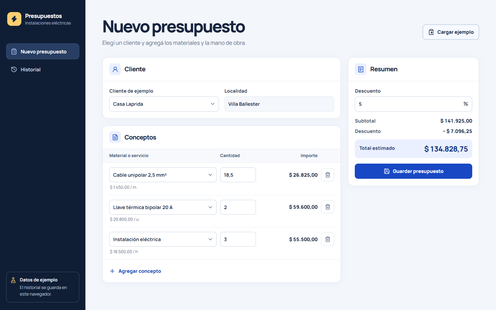

# Presupuestos para instalaciones eléctricas

Hice esta demo para mostrar cómo llevo una regla de negocio a una aplicación que se puede usar de punta a punta. Podés armar un presupuesto, revisar el total, guardarlo y volver a abrirlo desde el historial. El catálogo y los clientes son ficticios.

**[Probar la demo](https://ingeniasoftwareok.github.io/presupuestos-electricos/)** · [Ver el recorrido en video](docs/recorrido.mp4) · [Portfolio](https://ingeniasoftwareok.github.io/portfolio/)

[](https://github.com/IngeniaSoftwareok/presupuestos-electricos/actions/workflows/verificar.yml)



Para ver el flujo rápido, tocá **Cargar ejemplo**, cambiá una cantidad y guardá. En el detalle podés imprimirlo o elegir **Guardar como PDF** en el diálogo del navegador. El ejemplo, tal como viene, queda en **$134.828,75**.

## Cómo está armado

- **Edición web.** Abre con un enlace y guarda el historial en IndexedDB, en el mismo navegador. Usa el catálogo de ejemplo y calcula la vista previa con enteros en centavos. El historial queda en ese dispositivo y se puede perder si se borran los datos del sitio.
- **Edición completa.** Usa la misma interfaz en Next.js y TypeScript, con una API en Java 21 y Spring Boot y una base MySQL. Spring calcula el importe definitivo y guarda el presupuesto junto con sus renglones en una transacción. Flyway prepara las tablas y carga el catálogo.

Armé las dos ediciones para que cualquiera pueda probar la aplicación y, si le interesa el backend, pueda leer y ejecutar el recorrido completo con la base real.

## Lo que me interesaba resolver

**Reintentos.** Si se corta la conexión después de que se guardó un presupuesto, el editor conserva los datos y la clave del intento. MySQL tiene una restricción única por espacio y clave. La API recupera el presupuesto si el pedido coincide y responde `409` cuando alguien reutiliza esa clave con otros datos. En la prueba de integración, seis envíos concurrentes dejan un solo presupuesto.

**Importes.** Redondeo cada renglón antes de sumarlo y calculo el descuento sobre ese subtotal. El servidor consulta los precios del catálogo y guarda una copia de los valores usados, así el historial conserva el importe original.

**Historial.** Consulto hasta 15 presupuestos por vez y uso un cursor sobre el índice del historial. El listado trae los resúmenes. Los renglones se consultan al abrir el detalle.

**Acceso por navegador.** En la edición completa, el historial se asocia a una cookie aleatoria `HttpOnly` y `SameSite=Strict`. La base guarda su huella y las consultas filtran por ese espacio. Además, el servidor comprueba el origen de los guardados y usa consultas con parámetros. La demo está pensada para datos ficticios.

## Levantar la edición completa

Con Docker y Docker Compose, ejecutá este comando desde la raíz del repositorio.

```sh
docker compose up --build --wait
```

Abrí [http://localhost:8083](http://localhost:8083). La primera compilación descarga imágenes y dependencias. Compose publica solamente la web en la interfaz local. Si usás otra dirección, actualizá `DEMO_ORIGEN`. Para exponer la edición completa fuera del equipo, configurá HTTPS, `DEMO_COOKIE_SEGURA=true` y una contraseña de MySQL propia.

```sh
docker compose down
```

El volumen de MySQL conserva el historial entre arranques.

## Dónde seguir el código

| Si querés ver… | Empezá por… |
| --- | --- |
| El cálculo y el guardado | [GestionPresupuestos.java](api/src/main/java/ar/com/ingenia/presupuestos/aplicacion/GestionPresupuestos.java) |
| La transacción, la clave única y el índice | [ArchivoPresupuestos.java](api/src/main/java/ar/com/ingenia/presupuestos/persistencia/ArchivoPresupuestos.java) · [Migración SQL](api/src/main/resources/db/migration/V1__estructura.sql) |
| Cómo se conserva y reintenta un envío desde la pantalla | [editor.tsx](web/componentes/editor.tsx) |
| El guardado en la edición web | [navegador.ts](web/lib/navegador.ts) |
| Qué cubren las pruebas | [Integración con MySQL](api/src/test/java/ar/com/ingenia/presupuestos/GuardadoPresupuestosIT.java) · [Recorrido en navegador](web/tests/presupuestos.spec.ts) |

[API y comandos de verificación](docs/verificacion.md) · [Publicación estática en GitHub Pages](docs/publicar.md)
